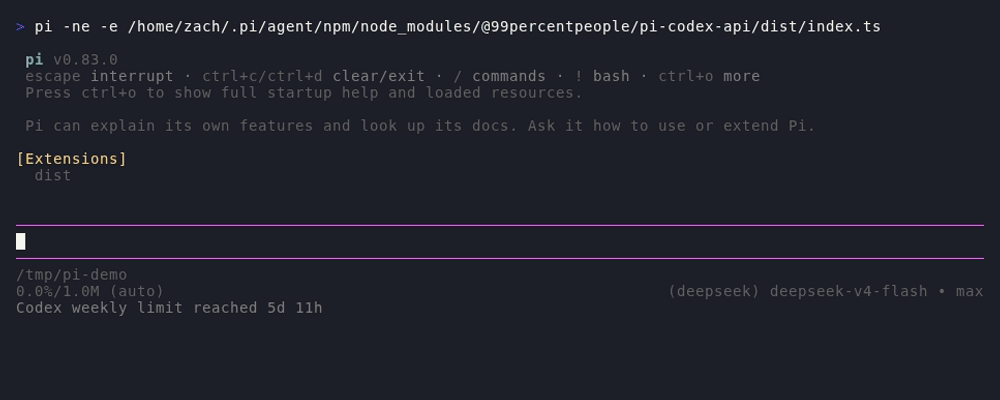
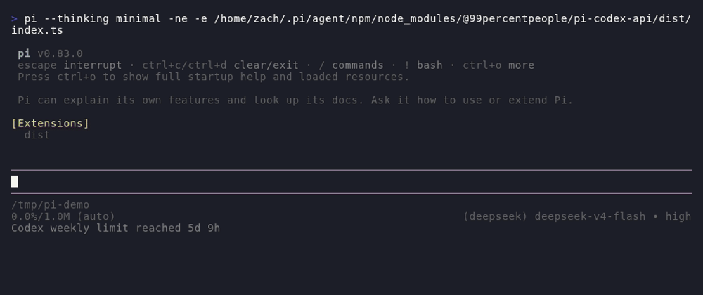
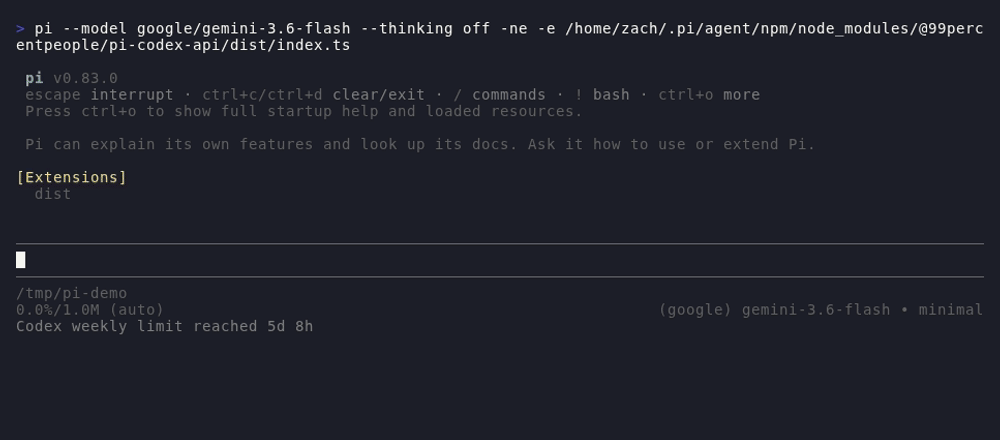

# @99percentpeople/pi-codex-api

Turn your ChatGPT subscription into Pi superpowers — multilingual text and
vision delegation, image generation, web search, Fast mode, and usage
monitoring — **no OpenAI API key required**.

[简体中文](README.zh-CN.md)

> **Pi 1.5 compatibility:** text/vision delegation supports the newer `openai`
> ChatGPT OAuth login. Search, images, quota, and reset cards still require a
> **separate `openai-codex` legacy OAuth login**; the tokens are not interchangeable.

## Highlights

- **Ask Codex from any model** — `codex_ask` sends a standalone multilingual
  text or vision request through `openai` ChatGPT OAuth or legacy Codex OAuth. Use it for an
  explicit Codex second opinion, translation, rewrite, review, or screenshot
  analysis while DeepSeek, Google, Claude, or another provider remains active.
- **Tool manager** — one `/99settings` submenu independently switches Search,
  Image, and Ask Codex On or Off. Disabled model tools disappear from the
  active prompt immediately.
- **Answer detail** — `/99settings` can leave subscription verbosity at the provider
  default or override normal ChatGPT OAuth replies and `codex_ask` with Low, Medium,
  or High detail.
- **Image generation & editing** — `codex_image` creates or edits images via
  your Codex subscription (default `gpt-image-2.5-flare`), and works from **any model**:
  even with a third-party provider active (DeepSeek, Google, …), it reuses Pi's
  logged-in `openai-codex` OAuth account (enable **Other providers** in
  `/99settings`).
- **First-party search** — `codex_search` runs web and image queries, page
  navigation, PDF screenshots, finance, weather, sports, and time lookups, and
  renders clean result cards instead of raw citations.
- **Fast mode** — requests the priority service tier on both subscription text
  transports, subject to model/account support; API-key traffic is not modified.
- **Usage at a glance** — the status bar shows remaining legacy Codex quota and
  reset time; `/codex-usage` shows your plan, masked account, limits, credits,
  and earned rate-limit reset cards.
- **Reset cards** — when you run out of messages, `/codex-redeem` redeems an
  earned reset card safely: pick a card, confirm, done.

## Demo

Subscription usage, limit-reached state, and reset-card redemption:



Web search with clean result cards (search → open a result → summarize):



Image generation with `gpt-image-2` (saved PNG + description):



## Authentication and compatibility

Recommended and regression-tested SDK: **Pi 1.5.0**. Pi introduced the newer
`openai` ChatGPT OAuth login in 0.99.0. The legacy delegation path retains its
Pi 0.84.1 minimum; the peer range preserves that path, not newer OAuth on old Pi.

| Feature | Required login | Request destination |
| --- | --- | --- |
| `codex_ask` text/vision | `/login openai` → **Sign in with ChatGPT** | OpenAI Responses API (`api.openai.com/v1`) through Pi |
| Legacy `codex_ask` | `/login openai-codex` | ChatGPT Codex backend through Pi |
| Search, image generation/editing, usage, reset cards | `/login openai-codex` | ChatGPT backend (`chatgpt.com/backend-api`) |

New Pi labels `openai-codex` **OpenAI Codex (legacy)**. An OpenAI API key is not a
subscription login. The extension does not move newer `openai` tokens to the
legacy backend, reuse legacy tokens for public API calls, or silently fall back
to API-key billing. Availability still depends on your account and workspace.

An active subscription model can use the tools without **Other providers**.
To invoke them while a third-party or API-key model is active, enable **Other
providers** in `/99settings`; this does not remove each tool's OAuth requirement.
If only newer `openai` OAuth is configured, `codex_ask` works, legacy commands
and quota status stay hidden, and search/image calls explain the missing legacy login.

## Ask Codex

`codex_ask` is disabled by default. Enable **Codex API → Tools → Ask Codex** in
`/99settings` before using it. It is deliberately opt-in. The active model should call it only when
someone explicitly asks to consult Codex or requests a Codex second opinion;
it must not recursively delegate routine work just because Codex is available.

Each call is standalone. Pi does **not** copy the surrounding conversation or
workspace into the request automatically, so the tool prompt must contain the
necessary context, target language, and output format. Optional controls include:

- an exact OAuth model ID from Pi's model list; use `openai/<id>` or
  `openai-codex/<id>` to disambiguate providers; omit it to reuse the active
  `openai` ChatGPT model, Pi's saved OpenAI default, or the legacy catalog
  default (see below);
- reasoning effort and per-call answer detail;
- up to five workspace images or recent conversation images for vision;
- a requested output-token cap (default 8,192), **best effort only**: Pi omits
  unsupported fields for ChatGPT sign-in, so the backend may ignore this cap.

With the newer login, no legacy model-catalog request is made. When another
provider is active, Pi's saved default is used only if `defaultProvider` is
`openai` and that model has OAuth. If no OpenAI default is saved and no legacy
login is available, select an OpenAI model with `/model` or specify `model`;
the extension does not pick an arbitrary model. If legacy OAuth is selected
and `model` is omitted, the existing live Codex catalog default is retained.
Explicitly requested unavailable models fail rather than switching providers.

Text calls reuse Pi's model-provider implementation and record their nested LLM
usage on the tool result. One-off delegated requests use a fresh routing session
and disable prompt-cache retention. With SSH Remote active, workspace image
inputs are read through the remote binary file adapter. Fast mode and answer
detail apply to both text transports; reasoning availability follows the selected
model. Recorded token usage is not a quota snapshot or evidence of API-key billing.

## Search output

`codex_search` keeps each result family readable:

- Web and image searches merge raw results with partial metadata into compact
  source cards. Partial failures and unrecognized response blocks stay visible.
  Citation links also resolve across short or missing separator lines.
- Pure search model output removes word-limit annotations and redundant blank
  lines while retaining full excerpts, dates and every source reference ID,
  including multiple IDs for the same URL.
- Mixed calls retain source cards, document bodies from `open`/`click`/`find`/
  `screenshot`, and structured lookup cards. One combined expand hint summarizes
  all hidden content. Source reference IDs and document line numbers remain
  available for subsequent navigation; unfamiliar result text is preserved.
- `open`, `click`, and `find` render grouped document previews; collapsed output
  shows at most three documents, while expanded output keeps every result.
- Weather forecasts, finance quotes, sports standings/schedules, and time
  lookups render structured cards. Weather alert details are reduced to their
  actionable summaries instead of injecting the provider's full object dump.
- Mixed model output compacts sources and lookups independently while retaining
  raw document blocks with their navigation metadata. Document bodies are stored
  once and rebuilt into cards when replaying history. All model search output
  is bounded to 2,000 lines or 50 KB and tells the model to open fewer
  references if truncation occurs.

For page workflows, search first and open returned reference IDs. Direct URLs
are best effort because Codex's browsing backend can reject otherwise valid
URLs. Keep page-navigation batches to three pages or fewer; `response_length`
and `open.lineno` do not reliably shorten page bodies.

The tool's optional `search_mode` accepts `cached`, `indexed`, or `live`.
`auto` is a user setting only: omit the argument to follow settings (Auto defaults
to `indexed`). Fixed settings take priority over the argument. If a lookup cannot
use that mode, the request switches to `indexed` and reports the change in its
result; for example, cached weather or live sports queries use `indexed`.

Current Codex backend limitations are surfaced as actionable result hints:

- Weather can become temporarily unavailable even with valid locations; retry
  once, then fall back to web search rather than looping over modes or locations.
- Crypto quotes require bare tickers such as `BTC` or `ETH`, not `BTC-USD`.
- NHL standings are not served by the structured sports lookup.
- `finance.market` is only a provider hint and does not reliably resolve
  international exchange listings such as `0700.HK`.

When a batched lookup silently omits one item, the extension compares returned
reference indexes with the request and reports the missing item's applicable
hint instead of presenting the batch as fully successful.

## Inline citations in assistant replies

On Pi versions exposing `registerMarkdownTransformer`, the extension formats
Codex citation markers such as `citeturn1view0` into domain-labelled Markdown
links. URLs come only from `codex_search` results on the active session branch.
Multiple references are supported; missing or conflicting reference IDs display
as `[turn1view0]` without inventing a URL. Terminal hyperlink support determines
whether links are clickable.

Formatting is display-only: assistant text and thinking are transformed, while
user messages, code examples, stored messages, and model context stay unchanged.
Incomplete trailing citations are hidden during streaming. Source mappings are
rebuilt on session load and tree navigation. Older Pi versions without the hook
keep the original rendering; no private rendering prototypes are patched.
This affects Pi's Markdown UI, not external Telegram/Feishu renderers or raw JSON
exports. Other marker families (image cards, navigation widgets, etc.) are not
handled by this citation formatter.

## Quick start

```bash
pi install npm:@99percentpeople/pi-codex-api
```

1. Use Pi **1.5.0** (or a compatible newer version).
2. For text/vision, run `/login openai`, choose **Sign in with ChatGPT**, then
   select an `openai` model with `/model`. Enable **Codex API → Tools → Ask Codex**
   in `/99settings`, then ask for an explicit Codex second opinion.
3. For search, images, quota, or reset cards, also sign in with
   `/login openai-codex` (**OpenAI Codex (legacy)**).
4. If a third-party model remains active, enable **Other providers** in
   `/99settings`. For newer OAuth delegation, save an OpenAI default in Pi
   or specify an exact `openai/<model-id>`.

With the legacy login available, ask *"generate an image of a neon ramen shop"*
or *"search the web for today's Rust releases"* and the model can call those tools.

When `@99percentpeople/pi-ssh-remote` is active, `codex_image.output_path` and
`referenced_paths` resolve through `@99percentpeople/pi-workspace-files`
and its remote binary backend. Generated
Base64 data is written directly through the remote adapter and references are
read directly from it, without creating local staging files.

## Commands

The commands below describe **legacy Codex** usage and reset cards, not the
newer public Responses API's quota. They are registered only after Pi confirms
an `openai-codex` OAuth login. A newer `openai` OAuth login alone does not show them; login
and model/auth changes are detected during the session. Pi currently has no
command-unregister API, so after logging out in the same running session use
`/reload` (or open another session) to remove commands registered earlier.

### `/codex-usage`

Shows a fresh snapshot of your subscription in one block:

```text
Codex usage

account · Plus (user@example.com)

codex
  weekly [█████████████░░░░░░░] 65% left resets in 5d 3h
  no additional credits

rate limit redeem
  Full reset (available, expires 2026-08-13 02:14 UTC+8)
```

- Plan type and masked email from Codex's official usage endpoint
- Each limit window shows remaining capacity as a bar; when exhausted it reads
  `limit reached` instead of `0% left`
- Earned reset cards, sorted by expiry, with local-time expiry timestamps
- The status bar mirrors this compactly: `Codex weekly 65% 5d 3h` →
  `Codex weekly limit reached 5d 14h`
- When a refresh fails the status never stays on the transient
  `Codex syncing…`: expired/invalid OAuth tokens show `Codex auth expired`
  (red), other failures keep the last known usage or show `Codex usage unavailable`
  until the next successful refresh

Usage refreshes automatically on session start, model select, and the configured
usage-poll interval; `/codex-usage` always forces a fresh read. Between refreshes,
the status-bar reset countdown advances locally from the last server timestamp
once per minute without making another request. A refresh simply re-synchronizes
that timestamp and the usage snapshot. Every usage request is capped at a
15-second timeout so a stalled backend cannot leave the status bar spinning.

### `/codex-redeem`

Redeems an earned rate-limit reset card when you're out of messages:

```text
──────────────────────────────────────────────
Select a reset credit to redeem (30s)

→ Full reset (expires 2026-08-03)
  Full reset (expires 2026-08-12)

↑↓ navigate  ↵ select  esc cancel
──────────────────────────────────────────────
      ↓ pick a card
──────────────────────────────────────────────
Redeem Full reset (expires 2026-08-12)? (30s)

→ No
  Yes

↑↓ navigate  ↵ select  esc cancel
──────────────────────────────────────────────
```

- Multiple cards show a picker (earliest expiry first); a single card skips to
  confirmation
- **No is the default**, so a stray Enter never consumes anything
- Redemptions are idempotent: a retry after a network failure can never consume
  a second card
- Without dialog UI, it falls back to a two-step confirm flow

## Settings

Configure under **Codex API** in `/99settings`:

- **Tools** opens one tool manager where **Search**, **Image**, and **Ask Codex**
  can each be switched **On** or **Off**. Disabled tools are removed from the active model
  prompt immediately; stale or concurrently queued calls are rejected before
  they reach Codex.
- **Fast mode** requests the priority service tier for normal ChatGPT OAuth
  replies and `codex_ask`, on both supported text transports.
- **Usage monitor** controls only legacy Codex background status refreshes.
  Turning it off leaves explicit `/codex-usage` and `/codex-redeem` available
  when legacy OAuth is configured. Normal newer OpenAI replies do not trigger
  legacy quota refreshes or parse their response headers as Codex quota.
- **Answer detail** selects provider default, Low, Medium, or High verbosity for
  normal subscription replies and `codex_ask` unless a call overrides it.
- **Other providers** permits calls from non-subscription active models
  (DeepSeek, Google, API-key OpenAI, …). Each feature still requires its own
  subscription OAuth login; the default **ChatGPT only** does not permit API-key traffic.
- **Search mode** and **Search context** configure search when its feature is on.
- **Image model** selects `gpt-image-2.5-flare` (default, fast generation),
  `gpt-image-2.5-sunburst` (precise editing), or `gpt-image-2` (compatibility).
  Existing settings without `imageModel` default to Flare. Changes apply on the next call.
- **Image quality** sets the GPT Image default when its feature is on.
- **Usage poll** controls the monitor refresh interval when its feature is on.

Settings live in `~/.pi/agent/99extensions.json` under the `codex-api`
namespace. Search and Image default to enabled; Ask Codex defaults to disabled.
Existing explicit tool settings are preserved; configurations without an
`askEnabled` setting also default to disabled.

### Images 2.5 availability

OpenAI [announced Images 2.5 on September 8, 2026](https://openai.com/index/introducing-chatgpt-images-2-5/).
The model IDs are `gpt-image-2.5-flare` and `gpt-image-2.5-sunburst`, not
`gpt-image-2.5`. This extension sends the selected ID to the existing Codex
subscription generation/edit endpoints, not the public paid Images API.
Both new IDs have mock request coverage. A single `gpt-image-2.5-sunburst`
generation passed a legacy OAuth live smoke test on **2026-11-09**; Flare and
image editing remain unverified live. Account availability depends on the Codex
rollout. If the backend rejects a new model, select `gpt-image-2` in **Image model**.
There is no silent fallback or automatic retry that could generate a second image.

The existing conservative size limits, five-reference limit, and
`auto`/`low`/`medium`/`high` quality choices are retained for the subscription
backend; additional public API options are not assumed to be supported.
The bundled prompting skill and demo were originally written for GPT Image 2.

## How it works

- Reuses Pi's subscription OAuth logins — no API key, MCP server, or separate
  search provider; newer OpenAI and legacy Codex credentials stay isolated
- Tokens are resolved per call inside Pi, never stored in settings or tool results
- `codex_ask` uses Pi's authenticated model completion API so provider overrides,
  token refresh, and transport remain inside the model registry. OAuth is checked
  again before completion; newer HTTP delegation also refuses actual `sk-` API
  keys even if the registry's OAuth snapshot became stale
- Legacy backend requests honor resolved base URLs only on the exact HTTPS
  `chatgpt.com` origin and reject URL credentials and redirects. Nullable optional
  headers delete defaults rather than sending `"null"`; mandatory authentication
  headers are always rebuilt from the selected legacy credentials
- The extension also ships the **`gpt-image-prompts`** skill for crafting
  production-grade image prompts — invoke it with `/skill:gpt-image-prompts`

## Validation and development

The Pi 1.5 adaptation has mock coverage for both login families, provider/model
selection, API-key rejection (including a real-registry stale-auth case),
nullable headers, usage isolation, and text/vision requests through Pi's real
Responses adapter with HTTP mocked.

**Live smoke test, 2026-11-09:** existing legacy OAuth successfully handled
standalone text, vision input, web search and opening a returned reference,
a structured time lookup, WHAM usage and reset-card reads, and one PNG generation
with `gpt-image-2.5-sunburst`. The PNG signature and dimensions were checked, and
the vision call correctly described the generated image. Ordinary OpenAI API-key
authentication was also confirmed to be refused before subscription delegation.

The newer `openai` ChatGPT OAuth path remains mock-covered only; it was not
live-tested without that login. Flare generation, image editing, other search
families, priority tier, and reset-card redemption were not live-tested in this
smoke run. No login/settings were changed and no reset card was consumed.
These results are account-scoped, not a guarantee of availability for every account.

```bash
bun install
bun run lint
node --import tsx --test tests/codex-api.test.ts tests/codex-api-oauth.test.ts
bun run check:privacy
bun run check
bun run pack:codex-api
pi -e ./extensions/codex-api/index.ts
```

Development SDK versions are pinned to Pi 1.5.0. Pi-provided runtime packages
remain external in `dist/codex-api/index.min.js`; the npm staging package also
contains its linked source map, both READMEs, license, and prompting skill.
